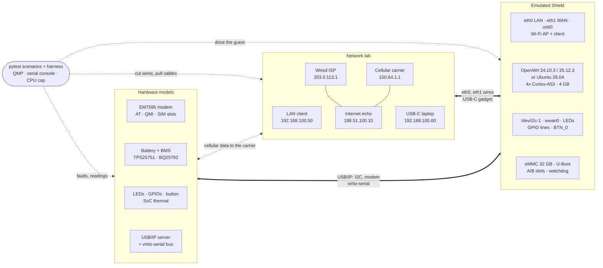
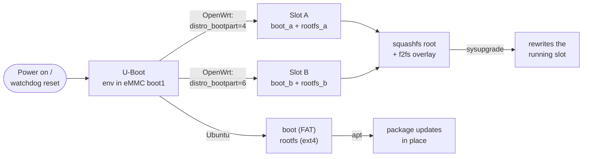
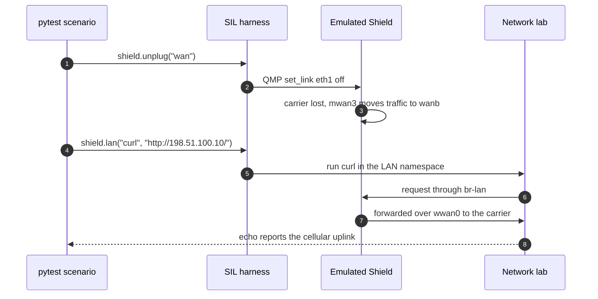

<div align="center">


# Shield SIL

**A full-system software-in-the-loop simulator for the Kform Shield portable secure router.**

Boot a real OpenWrt or Ubuntu image on an emulated Shield, wire it to a simulated
LAN, wired ISP and cellular carrier, and break the hardware and the network from
the outside to see what the software does.

[](https://github.com/DDNA-Engineering/Shield-SIL-public/actions/workflows/ci.yml)
[](LICENSE)


[](CHANGELOG.md)

[Quick start](#quick-start) ·
[How it works](#how-it-works) ·
[What it simulates](#what-it-simulates) ·
[Images](#choosing-an-image) ·
[Writing tests](#writing-a-scenario) ·
[Validation](#validation-status) ·
[Limitations](#known-limitations) ·
[Docs](#documentation)

</div>

> [!IMPORTANT]
> **Not yet validated on hardware.** Nothing here has been compared with a
> real Shield unit yet. Model parameters such as battery capacity, idle power,
> thermal constants and CPU speed are placeholders. Read
> [Known limitations](#known-limitations) before you trust a result.

## Why Shield SIL

Kform Shield is a battery-powered router with two Ethernet ports, an M.2 cellular modem,
Wi-Fi, USB-C power and data, and a front panel. Most of the bugs that matter on a
device like that live where software meets hardware and networks: an uplink that
flaps, a modem that hangs, a charger that drops out mid-update, a button held for
the wrong number of seconds. Those are slow and awkward to reproduce on a desk.

Shield SIL turns them into ordinary `pytest` tests. It emulates the board closely
enough that **Shield's own scripts are meant to run unmodified**: they see the same I2C buses,
LED and GPIO names, modem, eMMC layout and boot loader they see on the hardware.
Behind those interfaces sit models you can drive from a test.

- **Real software, not a mock.** The guest is an upstream OpenWrt or Ubuntu image
  built from official sources, set up with Shield's defaults.
- **Real driver interfaces.** I2C through `i2c-dev`, the EM7595 modem through
  ModemManager on `wwan0`, LEDs under `/sys/class/leds`, named GPIO lines, a USB
  network gadget on `usb0` and a `BTN_0` input event.
- **Real boot and update path.** Shield's eMMC partition layout, upstream U-Boot,
  A/B slots, `sysupgrade` and a hardware watchdog.
- **Held to Shield's compute.** Four Cortex-A53 cores, 4 GB RAM and 32 GB eMMC,
  with a CPU cap so a fast workstation cannot outrun the board.
- **Swappable images.** Pick OpenWrt 24.10.3, OpenWrt 25.12.3 or Ubuntu 26.04 per
  run, on QEMU `virt` or on an emulated i.MX 8M Plus (TF-A, U-Boot and the SoC's
  own kernel drivers), or [add your own](docs/swapping-images.md).
- **One command.** Everything runs in a container: `./sil up`, `./sil test`.

## Quick start

You need **Docker** and about **30 GB** of free disk. Everything else runs in a container.

**1. Get a Linux shell with Docker.**

- **Linux:** install Docker Engine and check that `docker run hello-world` works.
- **Windows:** install WSL2 with Ubuntu 24.04 (`wsl --install -d Ubuntu-24.04`) and
  Docker Desktop with *WSL integration* turned on for that distro. Run everything
  below in the Ubuntu terminal, and clone into the Linux filesystem (`~/`), not
  `/mnt/c`, which is much slower.

**2. Clone and run the unit tests** (a minute or two; the first run builds the SIL container):

```sh
git clone https://github.com/DDNA-Engineering/Shield-SIL-public.git ~/Shield-SIL
cd ~/Shield-SIL
./sil unit
```

**3. Boot a Shield** (the first run builds the image, about 5 to 10 minutes):

```sh
./sil up                       # default image: openwrt-24.10.3
```

It prints `ready in N s` once the Shield has booted, after about 2 to 3 minutes
(QEMU emulates the CPU in software). Leave it running; `Ctrl-C` stops it.

**4. Use it** from a second terminal in the same folder:

```sh
./sil ssh                                   # root shell on the Shield (no password)
./sil ssh ubus call shield status           # or run one command there
./sil lan                                   # shell on the simulated LAN client (192.168.100.50)
./sil lan curl -s http://192.168.100.1/     # e.g. reach LuCI from the LAN
./sil button 3                              # hold the front-panel button for 3 s
```

**5. Run the system tests:**

```sh
./sil test                                  # openwrt-24.10.3 (about 1 to 1.5 hours)
./sil test ubuntu-26.04                     # another image
./sil test openwrt-24.10.3 -k failover      # extra arguments go to pytest
./sil all                                   # unit tests, build, boot and system tests
```

<details>
<summary><b>All <code>./sil</code> commands</b></summary>

| Command | What it does |
| --- | --- |
| `./sil all [image]` | unit tests, build the image, boot it, system tests |
| `./sil build [image...\|--all]` | build guest images (default: the profile's image) |
| `./sil test [image] [pytest args]` | system tests against one image (builds it if missing) |
| `./sil unit` | unit tests, no VM |
| `./sil up [image] [--internet]` | boot the emulated Shield and keep it running (`Ctrl-C` stops); `--internet` gives it your real internet ([below](#using-your-own-internet)) |
| `./sil ssh [cmd...]` | root shell, or one command, on the running Shield from its LAN |
| `./sil lan [cmd...]` | shell, or one command, on the simulated LAN client |
| `./sil button [seconds]` | press the front-panel button (default 0.3 s) |
| `./sil images` | the image catalog and what is already built |
| `./sil shell` | a shell in the SIL container |

From Windows PowerShell, prefix any command with
`wsl -d Ubuntu --cd /home/<you>/Shield-SIL --`. More in [docker/README.md](docker/README.md).

</details>

## How it works

The SIL runs inside one privileged container. QEMU emulates the Shield as an
aarch64 `virt` machine. Around it, the harness builds a small world in Linux
network namespaces and runs the hardware models that stand in for Shield's chips.
Each part of the board reaches the guest through the same kind of Linux driver
interface the real part uses.



A test can cut or degrade any wire, pull a cable (the guest sees carrier loss),
unplug USB-C power, drain the battery, hang the modem or swap the SIM, then check
what the software did, from inside the Shield or from the LAN client. The ISPs do
not NAT, so the internet echo server can tell which uplink a request used. More
in [docs/architecture.md](docs/architecture.md) and
[docs/hardware-bus.md](docs/hardware-bus.md).

### Boot and update path

The OpenWrt and Ubuntu images boot from an emulated eMMC with Shield's partition
layout, through upstream U-Boot, and update the way the Shield firmware does.



OpenWrt's `sysupgrade` rewrites the slot it is running from, and switching between
slots A and B is a manual step (`fw_setenv distro_bootpart`), as on Shield. There
is no boot counter or automatic rollback. Details in
[docs/guest-interfaces.md](docs/guest-interfaces.md#emmc-and-ab-boot).

## What it simulates

| Shield hardware | In the SIL |
| --- | --- |
| i.MX8M Plus, 4x Cortex-A53, 4 GB RAM | QEMU `virt`, `-cpu cortex-a53 -smp 4 -m 4096M`; host CPU capped to 4 cores and each core to the A53's datasheet speed |
| 32 GB eMMC, U-Boot, A/B slots, watchdog | QEMU eMMC (boot0, boot1 and 32 GiB) with Shield's GPT layout per OS; upstream U-Boot; hardware watchdog fed by procd on OpenWrt |
| 2x GbE (LAN, WAN) | virtio NICs `eth0` (LAN) and `eth1` (WAN) on wires that can be cut, delayed, dropped or rate-limited |
| M.2 cellular modem (Sierra EM7595) | EM7595 on USB (AT, QMI, `wwan0` raw IP) driven by ModemManager; link quality follows signal strength |
| 1S battery, TPS25751 PD controller, BQ25792 charger | battery and charge-loop model; TPS25751 and BQ25792 register models on guest I2C bus 1 |
| USB-C power (PD sink) | PD contract negotiation at 5, 9, 12, 15 or 20 V; plug and unplug |
| USB-C data (`usb0`) | Shield's USB network gadget (CDC Ethernet over USB/IP) in `br-lan`, with a simulated laptop as USB host |
| Wi-Fi (u-blox MAYA-W260) | AP `mwiphy0-ap0` in `br-lan` (WPA2, hostapd) on a simulated radio, plus a simulated client in its own namespace inside the guest that joins it |
| Front-panel LEDs | `/sys/class/leds/{Heartbeat,System,User,WAN,WiFi,ETH,Battery}`; every change is recorded on the host |
| Front-panel button | `BTN_0` input events; `./sil button [seconds]` presses it |
| SoC thermals | first-order die temperature model (Shield has no fan or thermistor) |

The guest reads and drives the models through `shield-hw` on every image, and on
OpenWrt also through the ubus object `shield` (`ubus call shield status`). The
full list of driver interfaces is in [docs/guest-interfaces.md](docs/guest-interfaces.md).

## Choosing an image

| Image | What it is | Boot | Cellular | Failover |
| --- | --- | --- | --- | --- |
| `openwrt-24.10.3` **(default)** | upstream OpenWrt `armsr/armv8` with Shield's defaults, driver interfaces and mwan3 | eMMC, U-Boot, A/B | ModemManager on `wwan0` | mwan3 (carrier and upstream outage) |
| `openwrt-25.12.3` | the same on OpenWrt 25.12.3 | eMMC, U-Boot, A/B | ModemManager on `wwan0` | mwan3 |
| `ubuntu-26.04` | Ubuntu Server 26.04 arm64 set up as a Shield router (NetworkManager, ModemManager, hostapd); no ubus, LuCI or mwan3 | eMMC, U-Boot, one system partition | ModemManager on `wwan0` | route metrics (carrier loss only) |
| `openwrt-23.05.6` | older OpenWrt, kept for comparison | plain virtual disk | stand-in NIC `eth2` | mwan3 |
| `openwrt-24.10.3-imx8mp`, `openwrt-25.12.3-imx8mp` | upstream OpenWrt `imx/cortexa53` on an emulated i.MX 8M Plus: TF-A, U-Boot and the kernel's own i2c-imx, gpio-leds, gpio-keys and watchdog drivers ([docs/imx8mp.md](docs/imx8mp.md)) | eMMC (`mmcblk2`), TF-A, U-Boot, A/B | ModemManager on `wwan0` | mwan3 |
| `ubuntu-26.04-imx8mp` | Ubuntu 26.04 as above, on the emulated i.MX 8M Plus: TF-A, U-Boot, Ubuntu's own kernel with the SoC's drivers | eMMC (`mmcblk2`), TF-A, U-Boot, one system partition | ModemManager on `wwan0` | route metrics (carrier loss only) |

Pass the name to any command, for example `./sil up ubuntu-26.04` or
`./sil test openwrt-25.12.3`. `./sil images` lists the catalog and what is built.
Images are built from official upstream sources into `build/`, which git ignores.
To add your own image, see [docs/swapping-images.md](docs/swapping-images.md).

### Getting your software onto the Shield

The checkout is mounted at `/work` inside the SIL container, and the LAN client
reaches the Shield over SSH. Put your file under `build/` and copy it across from
the LAN client (`-O`, because OpenWrt's dropbear needs the classic scp protocol):

```sh
cp ~/my-tool_aarch64_generic.ipk build/
./sil lan scp -O -o StrictHostKeyChecking=no -o UserKnownHostsFile=/dev/null \
    /work/build/my-tool_aarch64_generic.ipk root@192.168.100.1:/tmp/
./sil ssh opkg install /tmp/my-tool_aarch64_generic.ipk
```

> [!NOTE]
> The Shield's internet is simulated by default, so `opkg update` from the public
> feeds needs `./sil up --internet` ([below](#using-your-own-internet)); otherwise
> bring packages built for `aarch64_generic` with you. Every boot starts
> from the clean image, so changes made in a running Shield are lost when it stops.
> To bake something in, add it to `image/overlay/` and rebuild with `./sil build`
> ([docs/swapping-images.md](docs/swapping-images.md)).

### Using your own internet

By default the Shield is on a closed, simulated internet, so every run is
repeatable and nothing leaves your machine. To give it your real internet
instead, add `--internet`:

```sh
./sil up --internet                         # or: ./sil up ubuntu-26.04 --internet
./sil ssh opkg update                       # public package feeds now work
./sil lan curl -sI https://openwrt.org      # so does the LAN client behind Shield
```

`up` then prints `internet: REAL`. Traffic leaves through your machine's own
connection (NAT, like a home router in front of Shield), on every uplink:

| Uplink | With `--internet` |
| --- | --- |
| Wired WAN (`eth1`) | ISP DHCP also hands out a DNS server; traffic goes out through your connection |
| Cellular (EM7595 `wwan0`) | the modem's bearer DNS works and data goes out through your connection, still shaped by the simulated signal |
| LAN, Wi-Fi and USB-C clients | reach the internet through Shield, as on a real network |

Everything else stays the same: failover still works, and tests can still pull
a cable, cut or degrade any wire, or drop the cellular signal. mwan3's
health checks (1.1.1.1, 1.0.0.1, 9.9.9.9, 149.112.112.112) go to the real
addresses, so a network that blocks ping makes Shield mark its uplinks offline,
as a real unit would. The simulated echo server (198.51.100.10) still answers,
so you can see which uplink a request used.

Good to know:

* It works the same with Docker Desktop on Windows (WSL2) and with Docker on
  Linux: the SIL container masquerades the Shield's traffic and Docker carries it
  out. Nothing changes on your machine outside the container.
* IPv4 only, like the rest of the SIL.
* The system tests use the closed internet. To run them on the real one anyway:
  `SIL_INTERNET=host ./sil test`. A profile can also turn it on for good with
  `[network] internet = "host"`.
* Only the Shield's own connections go out. Nothing on your network can connect
  in, so its SSH (root, no password on OpenWrt) and LuCI stay on the simulated LAN.
* Without Docker (below), `shield-sil --internet up` sets up the NAT on the host
  itself: while it runs it turns on IPv4 forwarding, adds an nftables table
  `shield_sil_sil0` and lets the lab's veth `sil0up` through the FORWARD chain,
  and it removes all of that when it stops.

## Writing a scenario

System tests are plain `pytest` functions. The `shield` fixture boots one
emulated Shield per session and resets it after each test.

```python
def test_something(shield):
    shield.unplug("wan")                        # pull the WAN cable (guest loses carrier)
    shield.net.wires["wwan"].set(delay_ms=150)  # degrade the cellular link
    with shield.board.lock:
        shield.board.pd.detach()                # unplug USB-C power
        shield.board.modem.wedge()              # EM7595 firmware hang
    shield.sh("ubus call shield bms")           # run anything on the Shield
    shield.lan("curl", "http://198.51.100.10/") # run anything on the LAN client
```



The existing suites in [`tests/system`](tests/system) cover networking and
failover, the eMMC and update path, power and charging, the modem, Wi-Fi, USB-C,
the button and the compute limits. They are good starting points.

## Validation status

GitHub CI runs quick checks on every push and pull request: lint, shell syntax,
the image catalog, unit tests and a collect-only pass over the system tests.
Image builds and full system runs happen on a developer machine with `./sil`,
because under emulation one image takes about 1 to 1.5 hours.

Last full system runs, 2026-11-10, on a Windows 11 workstation (WSL2, Docker,
no KVM). Every image was rebuilt from official sources, and none had a failure:

| Image | Passed | Skipped | Failed | Time |
| --- | :---: | :---: | :---: | :---: |
| `openwrt-24.10.3` | 47 | 3 | 0 | 1 h 14 min |
| `openwrt-25.12.3` | 47 | 3 | 0 | 1 h 33 min |
| `ubuntu-26.04` | 34 | 16 | 0 | 1 h 00 min |
| `openwrt-24.10.3-imx8mp` | 47 | 2 | 0 | 1 h 18 min |
| `openwrt-25.12.3-imx8mp` | 47 | 2 | 0 | 1 h 39 min |
| `ubuntu-26.04-imx8mp` | 34 | 16 | 0 | 1 h 03 min |

The two OpenWrt `-imx8mp` runs predate the last two changes (QEMU patch 0013
and Shield's pin map). Those were re-checked with a full `openwrt-25.12.3-imx8mp`
run and the board and button tests on all three `-imx8mp` images, with no failure.

Ubuntu skips the tests for features it does not have (A/B slots, mwan3, ubus,
`/etc/rc.button`). `openwrt-23.05.6` has not had a full run since the eMMC and
driver-interface work. The per-test breakdown for each image is in
[docs/validation-status.md](docs/validation-status.md).

If the uplinks do not recover after the reset between two tests, the harness
writes `diag-*.txt` to the run's folder under `build/runs/`. It holds the state
of the hardware models, the USB/IP server, every harness thread and the guest's
USB devices, which is usually enough to tell a harness fault from a guest one.

## Known limitations

| Limitation | What it means | Status |
| --- | --- | --- |
| **Not validated on hardware** | No result has been compared with a real Shield. Battery capacity and curve, idle power, thermal constants and CPU speed are placeholders ([docs/assumptions.md](docs/assumptions.md)) | needs a Shield unit |
| **CPU speed from the datasheet** | Each core is held to the A53's published Dhrystone score at 1.8 GHz (5336 DMIPS), not a measurement of a Shield ([docs/calibration.md](docs/calibration.md)). A host slower than a Shield, such as any host without KVM, stays slower | needs a Shield unit |
| **Timing** | QEMU reproduces the instruction set, not A53 timing. The speed cap bounds Dhrystone, not cache, memory or eMMC timing | needs a Shield unit |
| **Generic kernel** | The default images run the generic OpenWrt `armsr` or Ubuntu arm64 kernel on QEMU `virt`. The `-imx8mp` images run the i.MX 8M Plus kernel, TF-A and U-Boot on an emulated SoC with the SIL's own device tree; there the second GbE port is a PCIe NIC and there is no thermal sensor ([docs/imx8mp.md](docs/imx8mp.md)) | use the `-imx8mp` images (OpenWrt 24.10.3, 25.12.3, Ubuntu 26.04) |
| **Simulated Wi-Fi radio** | `mac80211_hwsim` and the standard Linux Wi-Fi stack, not the NXP IW611 driver; no RF range or interference; SSID and key are SIL defaults | by design |
| **Button is a USB HID device** | Same `BTN_0` event and `/etc/rc.button` path as gpio-keys, but a different input device name and bus | on QEMU `virt`; gpio-keys on the `-imx8mp` images |
| **No mwan3 on Ubuntu** | Ubuntu fails over on carrier loss only | by design for now |
| **OpenWrt 23.05.6 is the old setup** | No eMMC, driver interfaces or ModemManager; cellular data runs on a stand-in NIC | kept as a baseline |
| **mwan3 hotplug ordering** | On OpenWrt 24.10 and 25.12, mwan3 2.12 can run a stale `disconnected` event after a quick WAN unplug and replug, which leaves `wan` out of the `wan_wanb` policy. Between tests the harness detects this, restarts mwan3 and records a warning ([docs/guest-interfaces.md](docs/guest-interfaces.md#known-issue-mwan3-hotplug-ordering)) | looks like an mwan3 issue, not yet reported upstream; worked around in the harness |
| **Rare cellular miss after a reset** | Seen once, on a 4-core cloud VM, on `openwrt-25.12.3-imx8mp`: the guest's first `simple-connect` after a board reset returned `MobileEquipment.Unknown` because the emulated modem was not data-ready yet, and netifd did not retry, so `wanb` stayed down for the rest of the run | timing in the modem model; root cause open |
| **Modem re-attach miss** | After a board reset the guest's USB/IP helper sometimes misses the emulated modem coming back (about twice per full 25.12.3 run). A re-check every 10 s re-attaches it and logs `found by the periodic re-check`; it used to cost about 7 minutes | bounded to 10 s; root cause open |

## Running without Docker

<details>
<summary>Native Linux setup (Ubuntu 26.04 with root)</summary>

The eMMC needs QEMU 9.2 or newer (Ubuntu 26.04 ships 10.2), and building U-Boot
needs the cross compiler.

```sh
sudo apt-get install -y --no-install-recommends \
  qemu-system-arm qemu-utils ipxe-qemu dnsmasq-base iproute2 nftables curl \
  iputils-ping zstd kmod e2fsprogs xz-utils python3-venv docker.io \
  make gcc libc6-dev bison flex bc libssl-dev gcc-aarch64-linux-gnu git \
  dosfstools mtools
python3 -m venv .venv                       # Ubuntu refuses pip into the system Python
.venv/bin/pip install -e '.[test]'
.venv/bin/python -m pytest tests/unit
sudo -E image/build.sh                      # default image; or a name, or --all
sudo -E .venv/bin/shield-sil up             # boot and keep running
sudo -E .venv/bin/python -m pytest tests/system --sil-image openwrt-24.10.3
```

Call the tools by their `.venv/bin/` path under `sudo`, because sudo resets `PATH`.

</details>

## Repository layout

```
config/shield-v1.5.toml   board profile: compute, network, peripherals, default image
config/images/            image catalog, one file per selectable image
image/builders/           one build script per image family (openwrt, ubuntu)
image/overlay/            Shield setup applied to images: common/, openwrt/, ubuntu/
image/uboot/              upstream U-Boot build for the eMMC boot path
image/tfa/                upstream TF-A build for the i.MX 8M Plus images
image/dts/                the SIL's own Shield device tree for the i.MX 8M Plus images
qemu/                     upstream QEMU v10.2.1 build and the SIL's patches (imx8mp machine)
src/shield_sil/           harness: QEMU, CPU cap, network lab, wires, hardware bus, models
tests/unit/               model and relay tests, no VM
tests/system/             end-to-end scenarios against the booted guest
docker/                   the SIL container and ./sil
docs/                     design notes, interfaces, calibration, validation
```

## Documentation

| Document | Covers |
| --- | --- |
| [Architecture](docs/architecture.md) | the harness pieces, network lab and boot times |
| [i.MX 8M Plus machine](docs/imx8mp.md) | Shield's SoC on the SIL's patched QEMU: boot chain, real drivers, bridges |
| [Guest interfaces](docs/guest-interfaces.md) | every Shield driver interface the guest presents, eMMC and A/B boot |
| [Hardware bus](docs/hardware-bus.md) | the host-to-guest model channel and `shield-hw` |
| [Swapping images](docs/swapping-images.md) | the image catalog and adding your own image |
| [Calibration](docs/calibration.md) | the CPU speed cap and how to calibrate it |
| [Assumptions](docs/assumptions.md) | model parameters and where they come from |
| [Validation status](docs/validation-status.md) | per-test results for each image, and known gaps |
| [Running in a container](docker/README.md) | `./sil` details, WSL2 notes |
| [Changelog](CHANGELOG.md) | what each release changed, and its known issues |

## Contributing

See [CONTRIBUTING.md](CONTRIBUTING.md). Please run `./sil unit` before opening a
pull request, and a full `./sil test` for changes to the harness, models or images.
Report security issues as described in [SECURITY.md](SECURITY.md).

## License

Shield SIL is licensed under the Apache License 2.0. See [LICENSE](LICENSE).
Contributions are accepted under the same license.

Some files are third-party code under their own licenses, and are not covered by
the Apache License:

| Path | What it is | License |
| --- | --- | --- |
| `image/openwrt/packages/kmod-gpio-sim/src/`, `image/openwrt/packages/kmod-usb-gadget-vudc/src/` | Linux kernel sources vendored from linux-stable, and the patches to them | GPL-2.0 |
| `qemu/patches/` | patches to QEMU | GPL-2.0-or-later, as QEMU |
| `image/uboot/patches/` | patches to U-Boot | GPL-2.0-or-later, as U-Boot |

The guest images are built from upstream OpenWrt, Ubuntu, Linux, TF-A and U-Boot
under their own licenses; this repository does not ship them.
